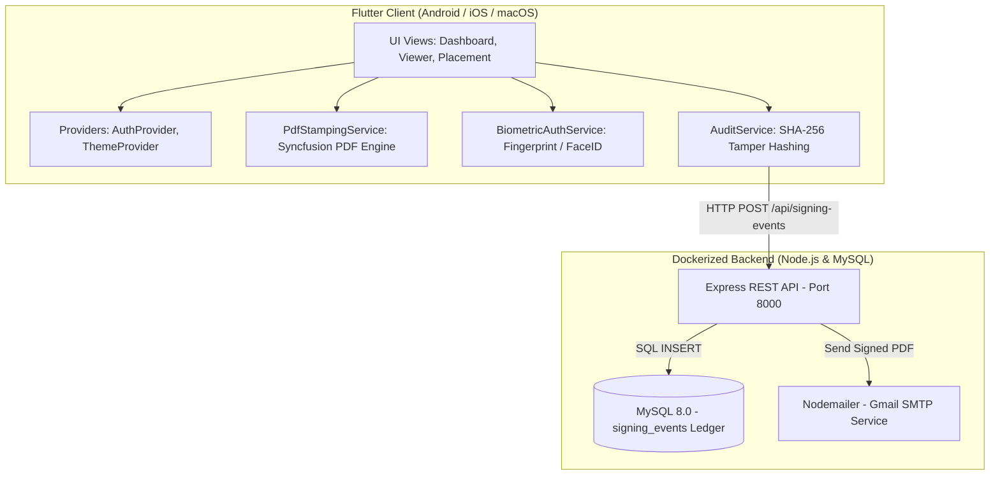

# 🖋️ eSign Platform — Complete Architecture & Developer Guide

Welcome to the **eSign Platform** codebase! This repository contains a complete, legally compliant electronic signature platform built with **Flutter** (Mobile/Desktop frontend) and **Node.js Express + MySQL** (Backend Audit Ledger & Verification Engine).

If your goal is to **understand the entire codebase, learn the underlying engineering logic, and rebuild or modify it from scratch**, this guide is your step-by-step roadmap.

---

## 🗺️ Table of Contents
1. [Where Do I Start? (Recommended Reading Order)](#-where-do-i-start-recommended-reading-order)
2. [High-Level System Architecture](#-high-level-system-architecture)
3. [End-to-End Data Flow](#-end-to-end-data-flow)
4. [Folder Structure & File Responsibilities](#-folder-structure--file-responsibilities)
5. [Step-by-Step Rebuild Roadmap (Day 1 to Production)](#-step-by-step-rebuild-roadmap-day-1-to-production)
6. [Core Technical Concepts Explained Simply](#-core-technical-concepts-explained-simply)
7. [Running & Testing the Entire Stack](#-running--testing-the-entire-stack)

---

## 🚀 Where Do I Start? (Recommended Reading Order)

To understand this codebase without feeling overwhelmed, read the files in this exact **5-stage order**:

```
Stage 1: Models (The Nouns)
   └── What data does the app care about?

Stage 2: Main & Providers (The Brain)
   └── How does the app start and manage global state?

Stage 3: Services (The Engine)
   └── How does PDF stamping, hashing, and biometrics work?

Stage 4: Views & UI (The Face)
   └── How does the user interact with the screens?

Stage 5: Backend & Database (The Ledger)
   └── How does the server record events and send emails?
```

### Detailed Reading Sequence:
1. **[frontend/lib/models/document_item.dart](file:///Users/abhijeetethiraj/Desktop/esign-platform/frontend/lib/models/document_item.dart)**: Understand what a document is (title, bytes, status: draft vs signed).
2. **[frontend/lib/models/signing_event.dart](file:///Users/abhijeetethiraj/Desktop/esign-platform/frontend/lib/models/signing_event.dart)**: Understand what legal evidence is stored (hashes, IP address, biometrics, timestamp).
3. **[frontend/lib/main.dart](file:///Users/abhijeetethiraj/Desktop/esign-platform/frontend/lib/main.dart)**: See how `MultiProvider` injects `AuthProvider` and `ThemeProvider` at the root.
4. **[frontend/lib/views/documents_screen.dart](file:///Users/abhijeetethiraj/Desktop/esign-platform/frontend/lib/views/documents_screen.dart)**: The dashboard where documents are imported, listed, and selected.
5. **[frontend/lib/widgets/signature_pad_modal.dart](file:///Users/abhijeetethiraj/Desktop/esign-platform/frontend/lib/widgets/signature_pad_modal.dart)**: Where the user draws their signature on a finger canvas.
6. **[frontend/lib/views/pdf_placement_screen.dart](file:///Users/abhijeetethiraj/Desktop/esign-platform/frontend/lib/views/pdf_placement_screen.dart)**: The interactive signature placement screen (drag box, tap to place, add spots).
7. **[frontend/lib/services/pdf_stamping_service.dart](file:///Users/abhijeetethiraj/Desktop/esign-platform/frontend/lib/services/pdf_stamping_service.dart)**: **The Core Engine!** Learn how signatures and DSC legal seals are drawn directly onto PDF bytes.
8. **[frontend/lib/services/audit_service.dart](file:///Users/abhijeetethiraj/Desktop/esign-platform/frontend/lib/services/audit_service.dart)**: How SHA-256 hashes are computed and synced to the backend.
9. **[backend/src/server.js](file:///Users/abhijeetethiraj/Desktop/esign-platform/backend/src/server.js)** & **[backend/src/db.js](file:///Users/abhijeetethiraj/Desktop/esign-platform/backend/src/db.js)**: How the Node.js API receives and stores audit records in MySQL.

---

## 🏛️ High-Level System Architecture



---

## 🔄 End-to-End Data Flow

Here is what happens from the moment a user clicks **"Sign Document"** to the moment an official legal email is delivered:

```
1. User taps "Sign Document" in [pdf_viewer_screen.dart]
       │
       ▼
2. [signature_pad_modal.dart] opens
   • User draws signature with finger
   • Converts canvas vector to PNG byte array (Uint8List)
       │
       ▼
3. Navigator transitions to [pdf_placement_screen.dart]
   • User drags signature box to desired page/coordinates
   • User can tap "Add Spot" for multi-signature agreements
       │
       ▼
4. User taps "Confirm & Stamp"
   • [biometric_auth_service.dart] prompts for device Fingerprint / FaceID
   • If verified, records "Device Biometric (Fingerprint/FaceID)"
       │
       ▼
5. [pdf_stamping_service.dart] runs mathematical coordinate scaling:
   • Converts screen coordinates (dp) into PDF points (72 DPI)
   • Stamps signature PNG image onto PDF bytes
   • Generates legal DSC verification badge (✔ Signature Valid, Date, Signer Email)
       │
       ▼
6. [audit_service.dart] computes SHA-256 cryptographic hashes:
   • originalDocumentHash = sha256(originalPdfBytes)
   • signedDocumentHash   = sha256(stampedPdfBytes)
   • Captures Signer IP address
       │
       ▼
7. Local Storage: [local_document_service.dart] saves stamped PDF locally
       │
       ▼
8. API Sync: POST /api/signing-events to backend
   • MySQL records immutable signing audit entry
   • Backend triggers automated email with signed PDF attachment
       │
       ▼
9. [signed_result_screen.dart] displays finalized document with Download & Share options
```

---

## 📁 Folder Structure & File Responsibilities

### Frontend (`frontend/lib/`)

| Folder / File | Responsibility |
| :--- | :--- |
| **`core/theme/app_theme.dart`** | Curated light and dark themes, styling tokens, button styles, colors. |
| **`core/network/api_client.dart`** | Central Dio HTTP client with timeouts, headers, and error handling. |
| **`core/network/api_endpoints.dart`** | URL definitions (`/api/health`, `/api/signing-events`, `/api/verify`). |
| **`models/document_item.dart`** | Model representing a local agreement (ID, title, bytes, date, `DocumentStatus`). |
| **`models/signing_event.dart`** | Complete legal audit contract (event ID, hashes, IP, biometrics, auth method). |
| **`models/user_session.dart`** | Logged-in user information (email, userId, displayName, auth tokens). |
| **`providers/auth_provider.dart`** | User authentication state management with persistent session restoration. |
| **`providers/theme_provider.dart`** | Theme mode state management (light / dark / system) with SharedPreferences. |
| **`services/docx_converter_service.dart`** | Converts imported Microsoft Word (`.docx`) files into clean PDF bytes. |
| **`services/pdf_picker_service.dart`** | File picker integration for selecting PDFs or Word docs from the device. |
| **`services/sample_pdf_service.dart`** | Generates realistic sample enterprise contracts for instant demo testing. |
| **`services/biometric_auth_service.dart`** | Wraps `local_auth` to authenticate signers via fingerprint / FaceID. |
| **`services/pdf_stamping_service.dart`** | Core PDF drawing engine: draws signatures, DSC verification seals, and certificates. |
| **`services/audit_service.dart`** | Computes SHA-256 hashes, grabs signer IP, and syncs signing records to backend. |
| **`services/local_document_service.dart`** | Stores signed PDFs in application storage, shares via share sheet, exports to Downloads. |
| **`views/login_screen.dart`** | Modern login screen with Keycloak / Google SSO + PKCE integration. |
| **`views/documents_screen.dart`** | Main dashboard: list of documents, status badges, search, and import actions. |
| **`views/pdf_viewer_screen.dart`** | Document reader with zoom controls and "Sign Document" trigger. |
| **`views/pdf_placement_screen.dart`** | Signature positioning screen with page navigation, tap-to-place, and drag gestures. |
| **`views/signed_result_screen.dart`** | Post-signing completion screen with legal audit certificate sheet, Download & Share. |
| **`widgets/document_card.dart`** | Reusable card widget displaying document details, date, and signed/ready badges. |
| **`widgets/signature_pad_modal.dart`** | Modal bottom sheet with interactive drawing canvas for signature capture. |

---

### Backend (`backend/`)

| File | Responsibility |
| :--- | :--- |
| **`src/server.js`** | Express server exposing `/api/health`, `/api/signing-events`, and `/api/signing-events/verify/:query`. |
| **`src/db.js`** | MySQL connection pool and auto-migration script for the `signing_events` table. |
| **`src/email.js`** | Automated email delivery service using Gmail App Password via Nodemailer. |
| **`Dockerfile`** | Production Alpine container definition running Node.js with non-root security. |
| **`docker-compose.yml`** | Docker Compose orchestration for MySQL 8.0 and Node.js API with `restart: unless-stopped`. |

---

## 🛠️ Step-by-Step Rebuild Roadmap (File-by-File Guide)

Follow these **6 sequential phases** to build or understand this application from scratch. Every step explicitly points to the exact file to create or inspect:

---

### 📦 Phase 1: Foundation, Styling & Core Data Models

Before writing any user interface, we establish the design system and data structures (the "nouns" of the application).

* **Step 1.1 — Package Manifest**  
  📄 File: [`frontend/pubspec.yaml`](file:///Users/abhijeetethiraj/Desktop/esign-platform/frontend/pubspec.yaml)  
  *What it does*: Declares all third-party dependencies required for PDF rendering (`syncfusion_flutter_pdf`, `syncfusion_flutter_pdfviewer`), finger drawing (`signature`), biometrics (`local_auth`), cryptography (`crypto`), state management (`provider`), and storage (`shared_preferences`, `path_provider`).

* **Step 1.2 — Design System & Theme Tokens**  
  📄 File: [`frontend/lib/core/theme/app_theme.dart`](file:///Users/abhijeetethiraj/Desktop/esign-platform/frontend/lib/core/theme/app_theme.dart)  
  *What it does*: Centralizes the app's visual identity. Defines `AppTheme.lightTheme`, `AppTheme.darkTheme`, curated primary blues, card background colors, typography, and rounded border radiuses.

* **Step 1.3 — User Session Model**  
  📄 File: [`frontend/lib/models/user_session.dart`](file:///Users/abhijeetethiraj/Desktop/esign-platform/frontend/lib/models/user_session.dart)  
  *What it does*: Holds the logged-in user profile (`userId`, `email`, `displayName`, `authMethod`). Includes `toJson()` and `fromJson()` for serialization.

* **Step 1.4 — Document Item Model**  
  📄 File: [`frontend/lib/models/document_item.dart`](file:///Users/abhijeetethiraj/Desktop/esign-platform/frontend/lib/models/document_item.dart)  
  *What it does*: Represents an agreement in the system. Holds `id`, `title`, `subtitle`, `pdfBytes` (as `Uint8List`), `updatedAt`, and the enum `DocumentStatus` (`readyToSign` vs `signed`).

* **Step 1.5 — Legal Signing Event Model**  
  📄 File: [`frontend/lib/models/signing_event.dart`](file:///Users/abhijeetethiraj/Desktop/esign-platform/frontend/lib/models/signing_event.dart)  
  *What it does*: The legal audit contract. Stores `signingEventId`, `documentHash`, `signedDocumentHash`, `userEmail`, `ipAddress`, `biometricVerification`, `authenticationMethod`, and timestamp.

---

### 👤 Phase 2: State Management & The Dashboard

Now that the data structures exist, we wire up global state and build the home screen where agreements are displayed.

* **Step 2.1 — Authentication State Provider**  
  📄 File: [`frontend/lib/providers/auth_provider.dart`](file:///Users/abhijeetethiraj/Desktop/esign-platform/frontend/lib/providers/auth_provider.dart)  
  *What it does*: Manages user login/logout lifecycle. Saves active user sessions to `SharedPreferences` so users don't get logged out when reopening the app.

* **Step 2.2 — Theme State Provider**  
  📄 File: [`frontend/lib/providers/theme_provider.dart`](file:///Users/abhijeetethiraj/Desktop/esign-platform/frontend/lib/providers/theme_provider.dart)  
  *What it does*: Allows switching between Light, Dark, and System theme modes and persists the selection.

* **Step 2.3 — Application Root & Provider Injection**  
  📄 File: [`frontend/lib/main.dart`](file:///Users/abhijeetethiraj/Desktop/esign-platform/frontend/lib/main.dart)  
  *What it does*: The application entry point. Wraps the app in `MultiProvider` to provide `AuthProvider` and `ThemeProvider`, routing users to `DocumentsScreen` if logged in, or `LoginScreen` if unauthenticated.

* **Step 2.4 — Login & SSO Screen**  
  📄 File: [`frontend/lib/views/login_screen.dart`](file:///Users/abhijeetethiraj/Desktop/esign-platform/frontend/lib/views/login_screen.dart)  
  *What it does*: Modern sign-in screen featuring Keycloak SSO with Google OAuth2 + PKCE and quick demo login bypass.

* **Step 2.5 — Sample Document Generator**  
  📄 File: [`frontend/lib/services/sample_pdf_service.dart`](file:///Users/abhijeetethiraj/Desktop/esign-platform/frontend/lib/services/sample_pdf_service.dart)  
  *What it does*: Uses `syncfusion_flutter_pdf` to programmatically build realistic 4-page enterprise service contracts in memory so the app is immediately testable upon first launch.

* **Step 2.6 — Document Card Component**  
  📄 File: [`frontend/lib/widgets/document_card.dart`](file:///Users/abhijeetethiraj/Desktop/esign-platform/frontend/lib/widgets/document_card.dart)  
  *What it does*: Reusable card widget displaying the document title, creation date, and status badges (`Ready to sign` vs `Signed`).

* **Step 2.7 — Documents Dashboard Screen**  
  📄 File: [`frontend/lib/views/documents_screen.dart`](file:///Users/abhijeetethiraj/Desktop/esign-platform/frontend/lib/views/documents_screen.dart)  
  *What it does*: The central dashboard. Lists all local documents, offers Word `.docx` and PDF import via file picker, pulls down to refresh, and allows selecting documents to read or sign.

---

### ✍️ Phase 3: Reading PDFs & Capturing Finger Signatures

Here we enable opening a PDF to read and presenting an interactive signature modal.

* **Step 3.1 — Signature Image Optimization Service**  
  📄 File: [`frontend/lib/services/signature_image_service.dart`](file:///Users/abhijeetethiraj/Desktop/esign-platform/frontend/lib/services/signature_image_service.dart)  
  *What it does*: Crops redundant empty transparent padding around drawn signatures, ensuring the resulting signature stamp is crisp and perfectly proportioned.

* **Step 3.2 — Signature Pad Modal**  
  📄 File: [`frontend/lib/widgets/signature_pad_modal.dart`](file:///Users/abhijeetethiraj/Desktop/esign-platform/frontend/lib/widgets/signature_pad_modal.dart)  
  *What it does*: Bottom sheet containing a touch canvas (`Signature` widget). Lets the user draw their signature with their finger, clear strokes, choose pen ink color (blue or black), and export raw PNG bytes (`Uint8List`).

* **Step 3.3 — PDF Reader Screen**  
  📄 File: [`frontend/lib/views/pdf_viewer_screen.dart`](file:///Users/abhijeetethiraj/Desktop/esign-platform/frontend/lib/views/pdf_viewer_screen.dart)  
  *What it does*: Displays the full PDF document using `SfPdfViewer.memory` with zoom-in and zoom-out buttons. Features a prominent "Sign Document" button that triggers `SignaturePadModal`. Upon adopting the signature, it navigates cleanly via `pushReplacement` to the Placement screen.

---

### 🎯 Phase 4: Signature Placement & The Mathematical Stamping Engine

This is the core engineering phase where coordinates are translated and signatures are drawn directly into PDF binaries.

* **Step 4.1 — Interactive Signature Placement Screen**  
  📄 File: [`frontend/lib/views/pdf_placement_screen.dart`](file:///Users/abhijeetethiraj/Desktop/esign-platform/frontend/lib/views/pdf_placement_screen.dart)  
  *What it does*: Renders the PDF in single-page mode. Displays an interactive draggable signature box. Supports tapping anywhere to snap the box, flipping between pages, and tapping "Add Spot" to place multiple signatures across different pages.

* **Step 4.2 — Mathematical PDF Stamping Engine & DSC Seals**  
  📄 File: [`frontend/lib/services/pdf_stamping_service.dart`](file:///Users/abhijeetethiraj/Desktop/esign-platform/frontend/lib/services/pdf_stamping_service.dart)  
  *What it does*: **The heart of the application.**
  1. Computes scaling: translates screen logical pixels (`dp`) into typographical PDF points (72 DPI).
  2. Embeds signature PNG images into the PDF bytes using `PdfBitmap`.
  3. Sorts signature spots in document reading order so the final spot receives the legal Digital Signature Certificate (DSC) verification seal (`✔ Signature valid`, signer email, timestamp).
  4. Appends a multi-page legal Certificate of Completion if requested.

* **Step 4.3 — Local Document Persistence & Export**  
  📄 File: [`frontend/lib/services/local_document_service.dart`](file:///Users/abhijeetethiraj/Desktop/esign-platform/frontend/lib/services/local_document_service.dart)  
  *What it does*: Saves stamped PDF files to the app's private sandbox storage, triggers the system share sheet (`share_plus`), and exports files directly to the public Android/iOS `Downloads` directory.

---

### 🔒 Phase 5: Cryptographic Hashing, Biometrics & Verification

Turning stamped documents into legally binding evidence compliant with ESIGN, eIDAS, and the IT Act.

* **Step 5.1 — Mobile Biometric Authentication Service**  
  📄 File: [`frontend/lib/services/biometric_auth_service.dart`](file:///Users/abhijeetethiraj/Desktop/esign-platform/frontend/lib/services/biometric_auth_service.dart)  
  *What it does*: Uses device hardware security (`local_auth`) to verify the signer's Fingerprint or FaceID immediately before stamping.

* **Step 5.2 — REST API Endpoints & Client**  
  📄 Files:  
  - [`frontend/lib/core/network/api_endpoints.dart`](file:///Users/abhijeetethiraj/Desktop/esign-platform/frontend/lib/core/network/api_endpoints.dart) (URL constants)  
  - [`frontend/lib/core/network/api_client.dart`](file:///Users/abhijeetethiraj/Desktop/esign-platform/frontend/lib/core/network/api_client.dart) (Configured Dio HTTP client)  
  *What it does*: Configures networking with timeout handling and error catching for communication with the backend.

* **Step 5.3 — Audit Service & SHA-256 Hashing**  
  📄 File: [`frontend/lib/services/audit_service.dart`](file:///Users/abhijeetethiraj/Desktop/esign-platform/frontend/lib/services/audit_service.dart)  
  *What it does*: Computes the SHA-256 cryptographic hash of the original and signed PDF files, fetches the signer's public IP address, and synchronizes the complete `SigningEvent` to the backend.

* **Step 5.4 — Signed Completion Result Screen**  
  📄 File: [`frontend/lib/views/signed_result_screen.dart`](file:///Users/abhijeetethiraj/Desktop/esign-platform/frontend/lib/views/signed_result_screen.dart)  
  *What it does*: Displays the final signed document, provides buttons to Save to Downloads and Share, and opens a modal showing the full legal audit certificate with hash verification.

---

### 🐳 Phase 6: Backend API, MySQL Ledger & Docker Orchestration

The server-side component that permanently records the signing audit trail and delivers signed copies via email.

* **Step 6.1 — Backend Dependencies & Configuration**  
  📄 File: [`backend/package.json`](file:///Users/abhijeetethiraj/Desktop/esign-platform/backend/package.json)  
  *What it does*: Defines Node.js dependencies: `express` (web server), `mysql2` (database pool), `nodemailer` (email delivery), `cors`, and `dotenv`.

* **Step 6.2 — MySQL Database Schema & Connection Pool**  
  📄 File: [`backend/src/db.js`](file:///Users/abhijeetethiraj/Desktop/esign-platform/backend/src/db.js)  
  *What it does*: Connects to MySQL with connection pooling and automatically runs `CREATE TABLE IF NOT EXISTS signing_events` on startup with indexed hash lookup columns.

* **Step 6.3 — Automated Email Service**  
  📄 File: [`backend/src/email.js`](file:///Users/abhijeetethiraj/Desktop/esign-platform/backend/src/email.js)  
  *What it does*: Uses Nodemailer to automatically email the signer a completion receipt containing the audit summary and the signed PDF attached.

* **Step 6.4 — Express REST API Server**  
  📄 File: [`backend/src/server.js`](file:///Users/abhijeetethiraj/Desktop/esign-platform/backend/src/server.js)  
  *What it does*: Exposes the endpoints:
  - `GET /api/health`: Health status.
  - `POST /api/signing-events`: Saves signing audit records into MySQL and triggers email delivery.
  - `GET /api/signing-events/verify/:query`: Public verification endpoint that looks up signatures by event ID or SHA-256 document hash.

* **Step 6.5 — Backend Containerization**  
  📄 Files:  
  - [`backend/Dockerfile`](file:///Users/abhijeetethiraj/Desktop/esign-platform/backend/Dockerfile) (Lightweight Alpine container with non-root security)  
  - [`backend/.dockerignore`](file:///Users/abhijeetethiraj/Desktop/esign-platform/backend/.dockerignore) (Prevents copying `node_modules` and local secrets)

* **Step 6.6 — Multi-Container Orchestration (Excluding Frontend)**  
  📄 File: [`docker-compose.yml`](file:///Users/abhijeetethiraj/Desktop/esign-platform/docker-compose.yml)  
  *What it does*: Spawns the `db` (MySQL 8.0) and `backend` (Express API) containers on a private bridge network with health checks, persistent disk volumes, and `restart: unless-stopped` policies.

---

## 💡 Core Technical Concepts Explained Simply

### 1. Why SHA-256 Cryptographic Hashing?
* **The Problem**: Anyone can edit a PDF with a free tool and claim the text was always there.
* **The Solution**: SHA-256 generates a unique 64-character fingerprint of the file bytes.
  - If you change a single comma, the hash completely alters.
  - Storing the signed PDF's hash in an immutable database ledger makes it legally undeniable (ESIGN, eIDAS, IT Act compliant).

### 2. Viewport to PDF Point Mapping (The Coordinate Formula)
* Mobile screens display at variable densities (dp).
* PDFs use points (1 inch = 72 points).
* When a user drops a signature box at screen coordinate `(x: 200, y: 500)`:
  $$\text{pdfX} = \text{screenX} \times \left(\frac{\text{pdfWidth}}{\text{screenWidth}}\right)$$
  $$\text{pdfY} = \text{screenY} \times \left(\frac{\text{pdfHeight}}{\text{renderedHeight}}\right)$$
* This ensures the signature appears in the exact corresponding location on any screen size.

### 3. Biometric Verification vs Normal Buttons
* Simply clicking a "Sign" button provides weak proof of identity.
* Integrating `local_auth` prompts Android Fingerprint or Apple FaceID before stamping.
* We record `Biometric Verification: Device Biometric (Fingerprint/FaceID)` in the legal audit certificate embedded into the PDF.

### 4. Memory Management in Flutter PDF Viewers
* `SfPdfViewer` uses native C++ PDFium bindings under the hood (`FPDF_DOCUMENT`).
* When transitioning from the Viewer screen to the Placement screen, we use `Navigator.pushReplacement` instead of `Navigator.push`.
* This cleanly unmounts the previous viewer, releasing its native memory handle before allocating the new viewer, completely eliminating `RenderTransform NEEDS-LAYOUT` assertion crashes.

---

## 🧪 Running & Testing the Entire Stack

### Running the Backend (Docker)
```bash
# Start MySQL & Express API in the background
docker compose up -d --build

# Verify API is healthy
curl http://localhost:8000/api/health
```

### Running the Frontend (Flutter)
```bash
cd frontend

# Verify static code analysis
flutter analyze

# Run automated unit & widget test suite
flutter test

# Launch on connected Android device or desktop
flutter run
```

---

*Happy Coding! Refer back to this guide whenever you need to trace any feature's data flow or expand the platform.*
